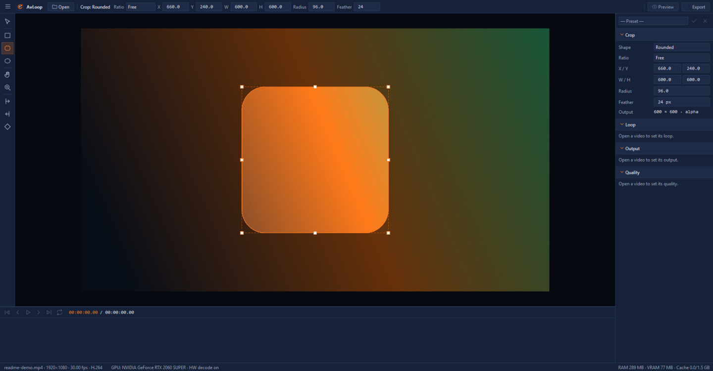

<p align="center">
  
</p>

<h1 align="center">AvLoop</h1>

<p align="center"><b>Cut any video into a seamless, transparent loop for OBS Studio.</b></p>

<p align="center">
  <a href="https://github.com/rubeldbc/avLoop/actions/workflows/ci.yml"></a>
  <a href="LICENSE"></a>
  
</p>



AvLoop is a Windows desktop app (C++20, Qt 6, FFmpeg). You choose a time range (In to Out) and a screen area (the
crop — a rectangle, a rounded rectangle or an ellipse) of any video, and AvLoop turns it into a **seamless looping
WebM with transparency**, sized for OBS's Media Source — up to 1080p, with crossfade or ping-pong loops, adjustable
frame rate and quality, and a preview that shows exactly what will be exported.

> **Status: early development (v0.1).** AvLoop is built in public, phase by phase
> ([the plan](phases/26-10-26-034934-AvLoop/README.md)). The feature list below says only what works today; everything
> else is on the [roadmap](#roadmap).

## Features — working today

- A compact window that opens maximized: the top bar (Open, Preview, Export only), the tool rail, the canvas with a
  drop zone, the side panel's Crop / Loop / Output / Quality sections (collapsible, remembered), the timeline's
  transport row and the status bar.
- **Navy** (default) and **Black** themes in orange — switch from the ☰ menu without a restart.
- The app draws its own icons; they stay sharp at any display scale (checked at 100%, 150% and 200%).
- Tools switch by their keys: **V** Selection, **M** / **U** / **E** crop shapes, **H** Hand, **Z** Zoom, **I** / **O**
  In / Out, **K** Keyframe.
- **Opens any video by its content** — Open, Ctrl+O, drag and drop, or `avloop.exe <file>`: MP4, MOV, MKV, WebM, AVI,
  WMV/ASF, FLV, MPEG-TS/M2TS, MPEG-PS/VOB, MXF, 3GP, OGV, Y4M, animated GIF and APNG; H.264, HEVC, AV1, VP8, VP9 (with
  alpha), MPEG-1/2/4, ProRes (4444 with alpha), DNxHR, MJPEG, CineForm, HAP, QuickTime Animation, PNG-in-MOV, Theora,
  FFV1 and uncompressed. A file that cannot be opened says why. (Animated WebP: no FFmpeg decodes it — convert it first.)
- **Frame-accurate decoding on the GPU** (D3D11VA, with a software fallback): phone rotation turned upright,
  anamorphic pixels made square, interlaced video deinterlaced, HDR tone-mapped to SDR, alpha kept.
- **A GPU canvas** (OpenGL): zoom about the cursor (10–800%), pan with the wheel, a middle-drag or the Hand; Fit with
  Ctrl+0, 100% with Ctrl+1. Transparent parts show a checkerboard.
- **The Selection tool** moves the video and scales it by its corner handles (Alt: about the centre), never
  distorting it; the options bar sets X, Y, Scale and W/H exactly, with Fit, Fill, Center, Flip H/V and Reset, and warns
  when the output would be upscaled.
- **Three crop tools** decide what is exported: a rectangle (**M**), a rounded rectangle (**U**) or an ellipse (**E**),
  drawn, moved and resized by eight handles; Shift keeps the ratio (a square, a circle), Alt works from the centre,
  the edges snap to the video's edges and centre (Ctrl: no snapping), arrows nudge 1 px (Shift: 10). Aspect ratios
  Free, Original, 1:1, 4:3, 3:4, 16:9, 9:16, 21:9, 3:2, 2:3, 4:5 or a custom W:H keep the crop's centre and area.
  Radius and Feather (0–200 px, softening inward) for the round shapes; the outside is dimmed; the side panel shows the
  output size and whether it needs transparency, and the status bar warns when the crop leaves the video.
- **A frame-accurate timeline**: the ruler (timecode or frame numbers — double-click it), thumbnails made on their
  own decoder, the In–Out range with its handles and bar, and the playhead; scrub fast while dragging and land on the
  exact frame; zoom with Ctrl+wheel down to 12 px a frame. **I** and **O** set In and Out at the playhead (the frame
  under it is the first or the last of the range), by the In/Out tools with a click, or by dragging; everything snaps
  to the output frame grid.
- **Playback** that never waits for the decoder: Space plays and pauses, loop on cycles In → Out, and a dropped frame
  is counted in the status bar — 1080p H.264 plays at 30 and 60 fps with none dropped.
- **Four loop modes** worked out exactly: Simple, Crossfade inside the range (Linear or Smooth), Ping-pong and Ping-pong
  with a smooth turn; Speed 0.10–4.00×; the output frame rate (Source, 15 … 60 or custom) with Nearest, Frame Blend
  or Motion Interpolation. The Loop panel shows the result ("Loop 4.50 s · 135 frames @ 30 fps"), and the crossfade
  shows on the timeline as a band whose edge you drag.
- **Undo and Redo** for every change (200 steps; one drag is one step).
- **Memory under control**: a bounded frame cache (1.5 GB by default) with a disk spill; the status bar shows the
  source, the GPU and RAM / VRAM / cache use.
- **One renderer** for what you will see and what you will export: output frame N of a loop is made on the GPU
  (OpenGL 3.3) or, without one, on the CPU with the same result (within 2/255) — the crop's mask and feather, the
  loop's blends and Motion Interpolation applied.
- `avloop-cli probe <video>`, `avloop-cli frame <video> --at N -o x.png` and, of a project,
  `avloop-cli frame <project.avloop> --at N -o x.png [--cpu]` for scripts; `avloop-cli version` shows the FFmpeg build
  in use and refuses a GPL build.

## Roadmap

Built in this order (each line is a phase of [the plan](phases/26-10-26-034934-AvLoop/control/01_PHASE_DEPENDENCY_GRAPH.md)):

1. **Preview window**: Live and Encoded, the seam marked, Around seam, backgrounds.
2. **Export**: VP9/VP8 alpha WebM, quality presets, target file size, verification.
3. **Projects** (`.avloop`), presets, autosave, settings.
4. Keyframes, the **Loop Finder**, a batch queue, GIF/APNG/MP4/ProRes 4444, and a Windows installer (v1.0.0).

## Using a loop in OBS

1. In OBS, add a **Media Source** and choose the exported `.webm` as the *Local File*.
2. Turn **Loop** on.
3. Turn **Use hardware decoding when available** off — OBS's hardware decoder drops the WebM's transparency.

## Download and install

The installer arrives with v1.0.0 on the [Releases](https://github.com/rubeldbc/avLoop/releases) page. Until then,
build from source.

## Build from source

Windows 10/11 x64, Visual Studio 2022 (C++), Node.js 20+ and Qt 6.8 (`msvc2022_64`):

```powershell
$env:QTDIR = 'C:\Qt\6.8.3\msvc2022_64'   # where Qt 6.8 is installed
scripts\fetch-deps.ps1                   # FFmpeg 7.1, LGPL shared build
scripts\build.ps1 -Config Release
scripts\test.ps1
build\bin\avloop.exe
```

Details, rules and the gates: [CONTRIBUTING.md](CONTRIBUTING.md).

## Keyboard shortcuts (working today)

| Action | Shortcut |
| --- | --- |
| Open a video | Ctrl+O |
| Selection · Crop: Rectangle · Rounded · Ellipse | V · M · U · E |
| Hand · Zoom | H · Z |
| Crop: keep the ratio · from the centre · no snapping (while dragging) | Shift · Alt · Ctrl |
| Crop: nudge 1 px · 10 px · remove · cancel a drawing · the whole video | arrows · Shift+arrows · Delete · Esc · double-click |
| Undo · Redo | Ctrl+Z · Ctrl+Y (Ctrl+Shift+Z) |
| Zoom: Fit · 100% · in · out | Ctrl+0 · Ctrl+1 · Ctrl+= · Ctrl+- |
| Zoom about the cursor · pan | Ctrl+wheel · wheel (Shift: across), middle-drag |
| Play / Pause · loop on/off | Space · L |
| Previous / next frame · ten frames | ← / → · Shift+← / Shift+→ |
| Go to In / Out · start / end of the file | Home / End · Ctrl+Home / Ctrl+End |
| Set In / Out at the playhead · clear them | I / O · Alt+I / Alt+O |
| Timeline: fit the file · fit In–Out · zoom · switch timecode/frames |  · Shift+ · Ctrl+wheel · double-click the ruler |
| Keyframe tool | K |

## Project structure

```text
src/core      the project model and the loop's maths (Qt Core only)
src/media     FFmpeg: probe, decode, normalize, cache, encode
src/render    the FrameRenderer (GPU and CPU) and the crop's mask
src/export    the export job, verification, the Loop Finder
src/ui        the main window, tools, canvas, timeline, panels, preview
src/app       avloop.exe            src/cli   avloop-cli.exe
resources     icons (SVG), themes (QSS with colour tokens), the app icon
tests         Qt Test unit tests (ctest -R avloop)
tools         gate tools (check-secrets, check-icons), walks, sample media
scripts       fetch-deps, build, test, format
phases        the development plan, its phase contracts and execution records
docs          the specification, the lore, screenshots
```

## Contributing

Contributions are welcome — read [CONTRIBUTING.md](CONTRIBUTING.md) and the [Code of Conduct](CODE_OF_CONDUCT.md).
Security reports: [SECURITY.md](SECURITY.md).

## License

AvLoop is MIT-licensed ([LICENSE](LICENSE)). It links Qt 6 (LGPLv3) and FFmpeg 7.1 (LGPL, with libvpx, dav1d and
zimg) dynamically; see [LICENSE-THIRD-PARTY.md](LICENSE-THIRD-PARTY.md).
