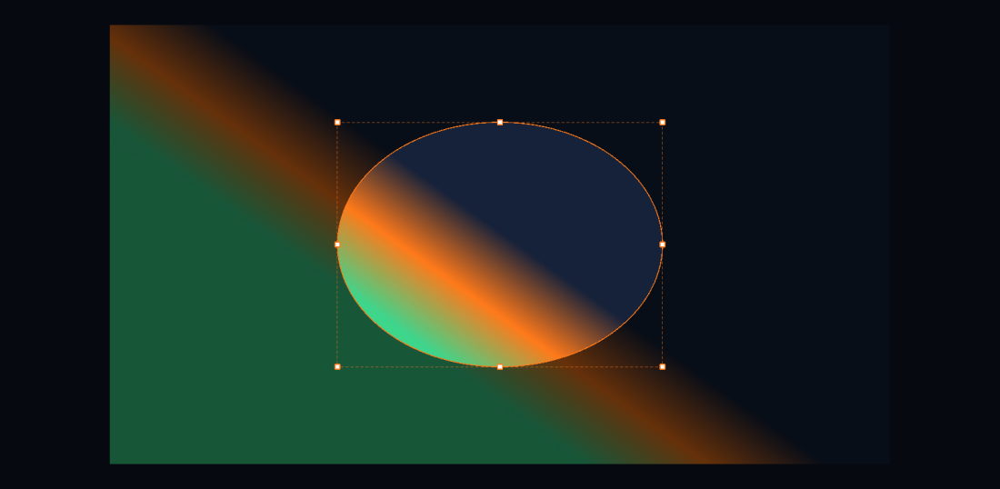
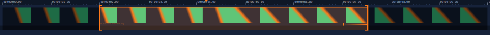
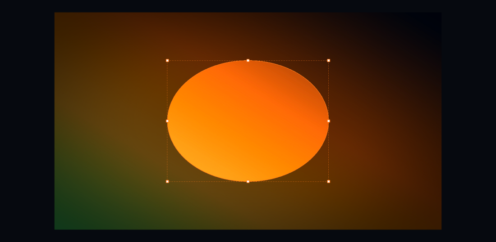
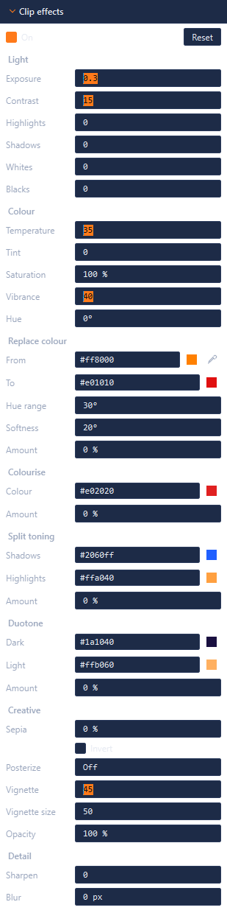
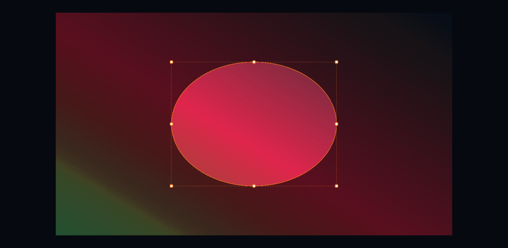
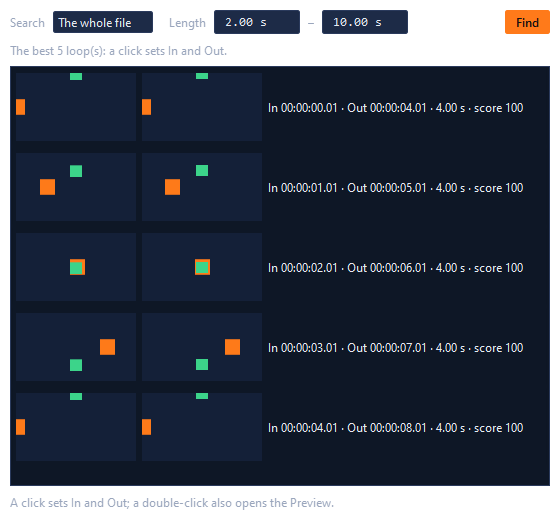
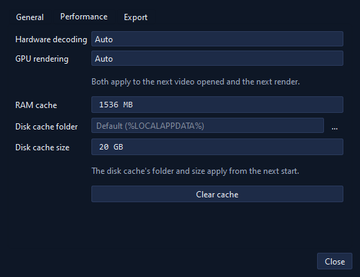
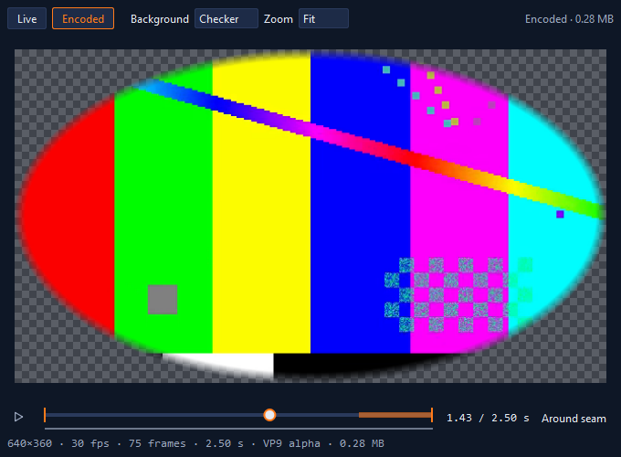
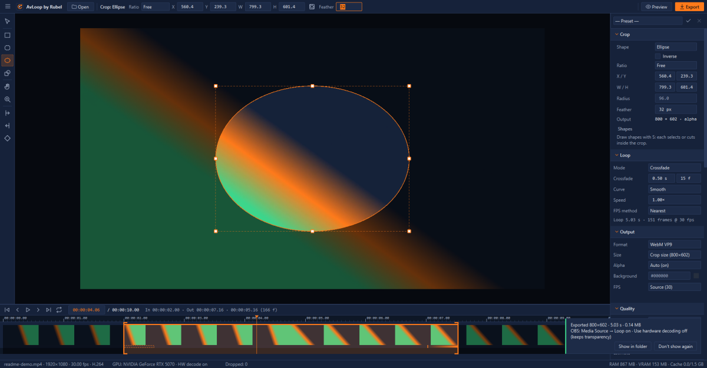
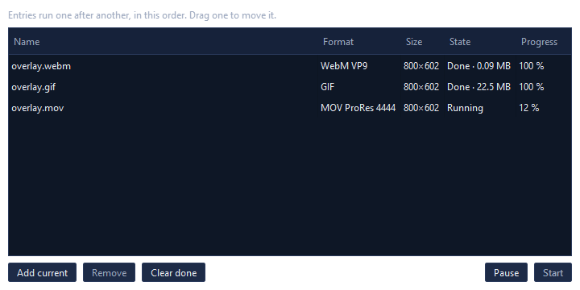

<p align="center">
  
</p>

<h1 align="center">AvLoop by Rubel</h1>

<p align="center"><b>Cut any video into a seamless, transparent loop for OBS Studio.</b></p>

<p align="center">
  <a href="https://github.com/rubeldbc/avLoop/actions/workflows/ci.yml"></a>
  <a href="LICENSE"></a>
  
</p>


AvLoop is a Windows desktop app (C++20, Qt 6, FFmpeg). You choose a time range (In to Out) and a screen area (the
crop — a rectangle, a rounded rectangle or an ellipse) of any video, and AvLoop turns it into a **seamless looping
WebM with transparency**, sized for OBS's Media Source — up to 1080p, with crossfade or ping-pong loops, adjustable
frame rate and quality, and a preview that shows exactly what will be exported. GIF, APNG, MP4 and ProRes 4444 too.

> **v1.1.0** — every item of the specification is built and walked
> ([the plan](phases/26-10-26-034934-AvLoop/README.md) and its execution records); new since 1.0.1: clip effects and
> colour-theme effects (an orange clip made red), the wheel zooming about the pointer, and Alt+drag keyframe copies.
> **[Download the installer](https://github.com/rubeldbc/avLoop/releases/tag/v1.1.0)** for Windows 10/11 x64.

## Features

- A compact window that opens maximized: the top bar (Open, Preview, Export only), the tool rail, the canvas with a
  drop zone, the side panel's Crop / Loop / Output / Quality sections (collapsible, remembered), the timeline's
  transport row and the status bar.
- **Navy** (default) and **Black** themes in orange — switch from the ☰ menu without a restart.
- The app draws its own icons; they stay sharp at any display scale (checked at 100%, 150% and 200%).
- Tools switch by their keys: **V** Selection, **M** / **U** / **E** crop shapes, **S** shapes, **H** Hand, **Z** Zoom, **I** / **O**
  In / Out, **K** Keyframe.
- **Opens any video by its content** — Open, Ctrl+O, drag and drop, or `avloop.exe <file>`: MP4, MOV, MKV, WebM, AVI,
  WMV/ASF, FLV, MPEG-TS/M2TS, MPEG-PS/VOB, MXF, 3GP, OGV, Y4M, animated GIF and APNG; H.264, HEVC, AV1, VP8, VP9 (with
  alpha), MPEG-1/2/4, ProRes (4444 with alpha), DNxHR, MJPEG, CineForm, HAP, QuickTime Animation, PNG-in-MOV, Theora,
  FFV1 and uncompressed. A file that cannot be opened says why. (Animated WebP: no FFmpeg decodes it — convert it first.)
- **Frame-accurate decoding on the GPU** (D3D11VA, with a software fallback): phone rotation turned upright,
  anamorphic pixels made square, interlaced video deinterlaced, HDR tone-mapped to SDR, alpha kept.
- **A GPU canvas** (OpenGL): the wheel zooms about the cursor (10–800%); pan with Shift+wheel, a middle-drag or the
  Hand; Fit with Ctrl+0, 100% with Ctrl+1. Transparent parts show a checkerboard.
- **The Selection tool** moves the video and scales it by its corner handles (Alt: about the centre), never
  distorting it; the options bar sets X, Y, Scale and W/H exactly, with Fit, Fill, Center, Flip H/V and Reset, and warns
  when the output would be upscaled.
- **Three crop tools** decide what is exported: a rectangle (**M**), a rounded rectangle (**U**) or an ellipse (**E**),
  drawn, moved and resized by eight handles; Shift keeps the ratio (a square, a circle), Alt works from the centre,
  the edges snap to the video's edges and centre (Ctrl: no snapping), arrows nudge 1 px (Shift: 10). Aspect ratios
  Free, Original, 1:1, 4:3, 3:4, 16:9, 9:16, 21:9, 3:2, 2:3, 4:5 or a custom W:H keep the crop's centre and area.
  Radius and Feather (0–200 px, softening inward) for the round shapes; the outside is dimmed; the side panel shows the
  output size and whether it needs transparency, and the status bar warns when the crop leaves the video.
  **Inverse** (the Crop section, or the toggle on the crop's bar) turns the selection inside out: the whole video is
  exported and the chosen area becomes a transparent hole in it, its feather softening outward.
- **Shapes** (**S**) inside the crop — or the whole video — say what is kept: rectangles, rounded rectangles and
  ellipses by a drag, polygons by clicks, freehand outlines by dragging round. Each shape **selects** (keeps its inside)
  or **cuts** (makes it transparent); select, move, resize, nudge and delete them on the canvas, and see them listed in
  the Crop section. The Preview and every export apply them exactly.

  

- **A frame-accurate timeline**: the ruler (timecode or frame numbers — double-click it), thumbnails made on their
  own decoder, the In–Out range with its handles and bar, and the playhead; scrub fast while dragging and land on the
  exact frame; zoom with Ctrl+wheel down to 12 px a frame. **I** and **O** set In and Out at the playhead (the frame
  under it is the first or the last of the range), by the In/Out tools with a click, or by dragging; everything snaps
  to the output frame grid.

  

- **Playback** that never waits for the decoder: Space plays and pauses, loop on cycles In → Out, and a dropped frame
  is counted in the status bar — 1080p H.264 plays at 30 and 60 fps with none dropped.
- **Four loop modes** worked out exactly: Simple, Crossfade inside the range (Linear or Smooth), Ping-pong and Ping-pong
  with a smooth turn — or **None**, the clip from In to Out as cut, with no loop at the end and no crossfade (the
  panel then says "Clip …", the Preview shows no seam, the file is named `…_clip_…`); Speed 0.10–4.00×; the output frame rate (Source, 15 … 60 or custom) with Nearest, Frame Blend
  or Motion Interpolation. The Loop panel shows the result ("Loop 4.50 s · 135 frames @ 30 fps"), and the crossfade
  shows on the timeline as a band whose edge you drag.
- **Keyframes** for the video's position and scale: **K** adds one at the playhead (or updates the one there); with
  keyframes, moving or scaling the video writes into the keyframe at the playhead, as in After Effects. Diamonds on the
  timeline's keyframe row — drag one to move it in time, Alt+drag to copy it, Delete removes it, **[** / **]** jump
  between them — and Linear or Ease per keyframe. The Preview and the export follow them frame by frame.
- **Clip effects** to correct or restyle the clip before export, in their own section of the side panel: Exposure,
  Contrast, Highlights, Shadows, Whites and Blacks; Temperature, Tint, Saturation, Vibrance and Hue; Sepia, Invert,
  Posterize, a Vignette and Opacity; Sharpen and Blur. The canvas shows them as you type, the Preview and every export
  exactly (made once, before the GPU or the CPU draws); **On** compares with the clip as it is, **Reset** clears
  them, each change is one Undo step. **Colour themes**: Replace colour turns one colour of the clip into another (an
  orange made red — pick it from the video with the eyedropper), Colourise makes the whole clip one colour, Split toning
  tints the shadows and the highlights, Duotone maps dark and light to two colours.

   

  

- **The Loop Finder** (Ctrl+L) looks for the In and Out where the video joins itself best: every frame of the search
  range (In–Out ± 5 s, or the whole file) reduced to a small fingerprint of what will be exported, every pair of the
  allowed lengths (2–10 s by default) compared — the pictures and their motion —, the best five shown with a 0–100
  score and both ends side by side. A click sets In and Out (one Undo step); a double-click opens the Preview too.

  

- **Undo and Redo** for every change (200 steps; one drag is one step).
- **Projects** (`.avloop`, plain JSON): New, Open, Save (Ctrl+S), Save As, Recent (10 projects and 10 videos), drag and
  drop or `avloop.exe <project>`. The title shows the project and `*` while it has unsaved changes; closing asks Save /
  Don't save / Cancel. A moved project finds its video beside it, else asks you to locate it. Work is **autosaved**
  every 2 minutes and offered back after a crash.
- **Presets**: the three built-in OBS presets (Overlay 512, Lower Third 1280, Vertical 1080) and your own — Loop,
  Output and Quality saved under a name, applied in one Undo step.
- **Settings** (Ctrl+,): theme, open the last project at start, autosave interval; hardware decoding, GPU rendering,
  RAM and disk cache, Clear cache; the export folder, the file name template, the OBS tips. **F1** lists the shortcuts.
  A daily log and, on a crash, a minidump in `%LOCALAPPDATA%\AvLoop\logs`.
- **About** (☰ → About AvLoop by Rubel): the version; the developer, Md. Kamrul Islam Rubel of Bangladesh, with an
  email address, a profile and WhatsApp as links; the licence and the libraries AvLoop is built with.

  

- **Memory under control**: a bounded frame cache (1.5 GB by default) with a disk spill; the status bar shows the
  source, the GPU and RAM / VRAM / cache use.
- **A Preview window** (F5) that shows only the exported part, exactly as it will be exported: always looping, a
  frame-accurate slider with the seam marked (the crossfade's frames, the ping-pong turns), Around seam, backgrounds
  (checker, black, white, green, navy, or your own image — an OBS scene) and zoom up to pixel-exact. **Encoded** mode
  encodes the loop with your settings and plays the file back through libvpx, as OBS will, with its real size.

  

- **One renderer** for what you will see and what you will export: output frame N of a loop is made on the GPU
  (OpenGL 3.3) or, without one, on the CPU with the same result (within 2/255) — the crop's mask and feather, the
  loop's blends and Motion Interpolation applied.
- **Export** (Ctrl+E) writes a **VP9 (or VP8) WebM with transparency** that OBS's Media Source loops seamlessly: in
  the background from a snapshot of the project (keep editing), with its progress and Cancel in the status bar
  (`Exporting 86/149 · 58% · 41 fps · ETA 0:02`), written to `name.part` and renamed only when complete, then
  re-opened and checked (frame count, rate, size, codec, alpha, the first frame a keyframe). A file OBS holds open is
  never half-overwritten: AvLoop waits for it, then saves beside it as `name (1).webm`. The **Output** section sets
  the format, the size (the crop's own, a long side of 1920 … 256, or a custom W×H with its ratio lock — always even,
  at most 1920), alpha (Auto: only when the loop has transparent parts; On; Off with a background colour) and the
  frame rate; the **Quality** section offers Low / Medium / High or Custom (CRF, Speed, max bitrate, two passes, or a
  **target file size** met within 5 %), with the estimated size beside it.

  

- **Four more formats**: **GIF** (a palette made from every frame, Bayer dithering, 1-bit transparency, loops for
  ever, at most 50 fps), **APNG** (full transparency, plays for ever), **MP4 H.264** by Windows' Media Foundation
  (hardware when there is a GPU; no transparency — the Background colour is behind; `+faststart`) and **MOV ProRes
  4444** with its alpha (large files for editors). No GPL encoder is ever used; a format this FFmpeg cannot write is
  shown disabled with the reason.
- **A batch queue**: Ctrl+Shift+E adds the project as it is now (named as Export would suggest, never over a file
  already there); Menu → Batch Queue lists the entries — name, format, size, state, progress —, drag one
  to reorder; Start runs them one after another, Pause stops the one under way (it starts over next time), Remove and
  Clear done tidy the list. A failed entry keeps its reason and the next one runs. The queue is kept in
  `%APPDATA%\AvLoop\queue.json`: after a restart, unfinished entries are back as Pending.

  

- `avloop-cli probe <video>`, `avloop-cli frame <video> --at N -o x.png`, of a project
  `avloop-cli frame <project.avloop> --at N -o x.png [--cpu]`, `avloop-cli export <project.avloop> -o x.webm
  [--format webm-vp9|webm-vp8|gif|apng|mp4-h264|mov-prores]` and
  `avloop-cli find <video|project>` for scripts; `avloop-cli version` shows the FFmpeg build in use and refuses a
  GPL build.

## What is not in this version

Audio, output above 1080p, a rotation tool, text or stickers, several layers or crop areas, keyframes of the crop,
macOS or Linux, an auto-updater, licence keys, telemetry and code signing are outside this version's specification
(`docs/SPEC.md` §1.3).

## Using a loop in OBS

1. In OBS, add a **Media Source** and choose the exported `.webm` as the *Local File*.
2. Turn **Loop** on.
3. Turn **Use hardware decoding when available** off — OBS's hardware decoder drops the WebM's transparency.

WebM is the format for OBS. MOV ProRes 4444 keeps the alpha too, at many times the size; MP4 has no transparency.

## Download and install

Download `AvLoop-1.1.0-setup.exe` (about 45 MB) from the
[v1.1.0 release](https://github.com/rubeldbc/avLoop/releases/tag/v1.1.0) — its SHA-256 is beside it — and run it.
It installs as *AvLoop by Rubel*; installed over 1.0.x, it keeps your settings, presets and batch queue. A project
saved with clip effects (file version 2) does not open in 1.0.x.

- It installs for you alone (no administrator needed) or, if you choose, for everyone on the PC; it adds a Start menu
  entry, optionally a desktop icon, and opens `.avloop` projects with a double-click.
- Everything AvLoop needs comes with it (Qt, FFmpeg's LGPL DLLs, the Visual C++ runtime); it never uses the network.
- Uninstalling (Settings → Apps) removes the program, the `.avloop` association, the autosave, the logs and the disk
  cache, and keeps your settings, presets and batch queue (`%APPDATA%\AvLoop`).
- It is not code-signed: Windows SmartScreen may ask you to confirm (More info → Run anyway).

## Build from source

Windows 10/11 x64, Visual Studio 2022 (C++), Node.js 20+ and Qt 6.8 (`msvc2022_64`):

```powershell
$env:QTDIR = 'C:\Qt\6.8.3\msvc2022_64'   # where Qt 6.8 is installed
scripts\fetch-deps.ps1                   # FFmpeg 7.1, LGPL shared build
scripts\build.ps1 -Config Release
scripts\test.ps1
build\bin\avloop.exe
scripts\deploy.ps1 -NoBuild                # deploy\: what the installer installs
& 'C:\Program Files (x86)\Inno Setup 6\ISCC.exe' installer\AvLoop.iss   # installer\Output\AvLoop-<version>-setup.exe
```

Details, rules and the gates: [CONTRIBUTING.md](CONTRIBUTING.md).

## Keyboard shortcuts

| Action | Shortcut |
| --- | --- |
| Open a video or a project | Ctrl+O |
| Selection · Crop: Rectangle · Rounded · Ellipse | V · M · U · E |
| Hand · Zoom | H · Z |
| Crop: keep the ratio · from the centre · no snapping (while dragging) | Shift · Alt · Ctrl |
| Crop: nudge 1 px · 10 px · remove · cancel a drawing · the whole video | arrows · Shift+arrows · Delete · Esc · double-click |
| Undo · Redo | Ctrl+Z · Ctrl+Y (Ctrl+Shift+Z) |
| Zoom: Fit · 100% · in · out | Ctrl+0 · Ctrl+1 · Ctrl+= · Ctrl+- |
| Zoom about the cursor · pan | wheel (or Ctrl+wheel) · Shift+wheel (across), middle-drag |
| Preview window · in it: play/pause, a frame back / on | F5 · Space, ← / → |
| Export · add to the batch queue | Ctrl+E · Ctrl+Shift+E |
| Play / Pause · loop on/off | Space · L |
| Previous / next frame · ten frames | ← / → · Shift+← / Shift+→ |
| Go to In / Out · start / end of the file | Home / End · Ctrl+Home / Ctrl+End |
| Set In / Out at the playhead · clear them | I / O · Alt+I / Alt+O |
| Timeline: fit the file · fit In–Out · zoom · switch timecode/frames | `\` · `Shift+\` · Ctrl+wheel · double-click the ruler |
| Keyframe: add or update at the playhead · previous / next · delete the one at the playhead | K · [ / ] · Delete |
| Keyframe on the timeline: move · copy | drag · Alt+drag |
| Save · Save As | Ctrl+S · Ctrl+Shift+S |
| Settings · the list of shortcuts · the Loop Finder | Ctrl+, · F1 · Ctrl+L |

## Project structure

```text
src/core      the project model and the loop's maths (Qt Core only)
src/media     FFmpeg: probe, decode, normalize, cache, encode
src/render    the FrameRenderer (GPU and CPU) and the crop's mask
src/export    the export job, its check, the formats, the batch queue, the size estimate, the Loop Finder
src/ui        the main window, tools, canvas, timeline, panels, preview
src/app       avloop.exe            src/cli   avloop-cli.exe
resources     icons (SVG), themes (QSS with colour tokens), the app icon
tests         Qt Test unit tests (ctest -R avloop)
tools         gate tools (check-secrets, check-icons), walks, sample media
scripts       fetch-deps, build, test, format, deploy
installer     the Inno Setup script          licenses   the LGPL and GPL texts the installer carries
phases        the development plan, its phase contracts and execution records
docs          the specification, the lore, screenshots
```

## Contributing

Contributions are welcome — read [CONTRIBUTING.md](CONTRIBUTING.md) and the [Code of Conduct](CODE_OF_CONDUCT.md).
Security reports: [SECURITY.md](SECURITY.md).

## License

AvLoop is MIT-licensed ([LICENSE](LICENSE)). It links Qt 6 (LGPLv3) and FFmpeg 7.1 (LGPL, with libvpx, dav1d and
zimg) dynamically; see [LICENSE-THIRD-PARTY.md](LICENSE-THIRD-PARTY.md). The installer carries these notices and the
licence texts (`licenses/`).
